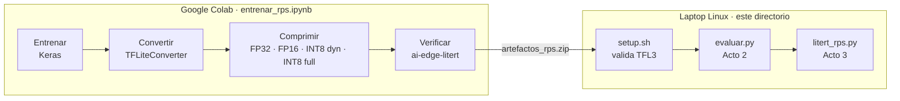

# Demostración: del archivo `.tflite` a la inferencia en vivo con LiteRT

Demostración práctica del mini-taller **"Despliegue de aprendizaje automático en sistemas embebidos: el caso de LiteRT"**. En 15–20 minutos recorre el flujo de la presentación con un clasificador de **Piedra, Papel o Tijera**, ejecutado en CPU sobre una laptop Linux:

1. **Acto 1 – El artefacto:** el mismo modelo convertido a cuatro formatos (FP32, FP16, INT8 dinámico e INT8 completo).
2. **Acto 2 – La medición:** tamaño, RAM, latencia y precisión de cada variante, con las dos APIs de LiteRT (`Interpreter` y `CompiledModel`).
3. **Acto 3 – En vivo:** clasificación desde la cámara, cambiando de modelo con una tecla.

> El tutorial guiado para los participantes es un documento aparte (en desarrollo).

---

## Contenido

1. [Qué cubre y qué no](#1-qué-cubre-y-qué-no)
2. [Requisitos](#2-requisitos)
3. [Estructura de archivos](#3-estructura-de-archivos)
4. [Preparación (una sola vez)](#4-preparación-una-sola-vez)
5. [Guion de la demostración](#5-guion-de-la-demostración)
6. [Resultados esperados y criterios de éxito](#6-resultados-esperados-y-criterios-de-éxito)
7. [Checklist previo a la demostración](#7-checklist-previo-a-la-demostración)
8. [Plan de contingencia](#8-plan-de-contingencia)
9. [Cómo funciona el código](#9-cómo-funciona-el-código)
10. [Referencia de comandos](#10-referencia-de-comandos)
11. [Solución de problemas](#11-solución-de-problemas)
12. [Referencias](#12-referencias)

---

## 1. Qué cubre y qué no



| Diapositiva | Concepto | Dónde se demuestra |
|---|---|---|
| 3 | Convertir, comprimir, ejecutar | Cuaderno (convertir, comprimir) y laptop (ejecutar) |
| 5 | Formato `.tflite` (FlatBuffer) | Acto 1: cabecera `TFL3` |
| 5 | `Interpreter` vs `CompiledModel` | Acto 2: ambas APIs en la misma tabla; Acto 3: `--api` |
| 6 | Aceleración heterogénea | Acto 2: `evaluar.py --gpu` (GPU si hay driver Vulkan; si no, se explica por qué) |
| 7 | FP32 / FP16 / INT8 y la aclaración sobre la RAM | Acto 2: columnas *Tamaño* y *RAM modelo* |
| 8 | PTQ sin y con dataset representativo | Acto 2: `rps_int8_dyn` vs `rps_int8_full`, columna *Coincide FP32* |
| 11 | Tamaño, latencia y precisión | Acto 2: tabla completa |
| 13 | Cargar, medir latencia, medir precisión | Actos 2 y 3 |

**Fuera de alcance (se mencionan, no se demuestran):**

- Conversión desde PyTorch con `litert-torch` (diapositiva 9).
- LiteRT Community Hub (diapositiva 10).
- NPU, que en Linux depende de silicio Qualcomm (diapositiva 6).
- QAT (diapositiva 8).

---

## 2. Requisitos

| Elemento | Requisito |
|---|---|
| Sistema | Linux x86_64 (probado en Ubuntu 22.04 y 24.04) |
| Python | 3.10 o superior (probado con 3.10 y 3.13) |
| Dependencias | `requirements.txt`: `ai-edge-litert==2.3.0`, NumPy, OpenCV |
| Cámara | Webcam en `/dev/video*` (opcional: hay modo de contingencia con imagen fija) |
| GPU | Opcional. LiteRT usa WebGPU sobre Vulkan; requiere un driver Vulkan funcional |
| Modelos | Generados con `entrenar_rps.ipynb` en Google Colab (requiere cuenta de Google) |

---

## 3. Estructura de archivos

```text
demostracion/
├── Demostracion.md          # Este documento: preparación, guion y referencia
├── entrenar_rps.ipynb       # Colab: entrena, convierte a 4 variantes, verifica y exporta
├── requirements.txt         # Dependencias (ai-edge-litert fijado)
├── setup.sh                 # Crea .venv, instala, valida modelos/datos/cámara/Vulkan
├── verificar_entorno.py     # Registra el equipo y las capacidades de LiteRT en docs/entorno.md
├── rps_common.py            # Módulo común: validación, preprocesamiento y Motor (2 APIs)
├── evaluar.py               # Acto 2: tabla de tamaño, RAM, latencia y precisión
├── litert_rps.py            # Acto 3: clasificación en vivo
├── modelos/                 # (del cuaderno) rps_fp32/fp16/int8_dyn/int8_full.tflite,
│                            #   labels.txt, manifest.json
├── datos/                   # (del cuaderno) test/Piedra|Papel|Tijera/*.jpg + README.md (licencia)
├── resultados/              # (de evaluar.py) resultados.md y resultados.csv
├── docs/
│   ├── entorno.md           # (de verificar_entorno.py) evidencia del equipo de la demo
│   └── trazabilidad.md      # Hallazgos de la revisión → cambios → evidencia de cierre
└── test_hand.jpg            # (tecla 's') imagen de contingencia con su iluminación real
```

---

## 4. Preparación (una sola vez)

### 4.1 Generar los modelos en Colab

1. Abra `entrenar_rps.ipynb` con el botón **Abrir en Colab** que aparece al inicio del cuaderno.
2. *Entorno de ejecución → Cambiar tipo de entorno de ejecución → GPU* (opcional, acelera el entrenamiento).
3. *Entorno de ejecución → Ejecutar todas.* Al terminar se descarga `artefactos_rps.zip`.
4. Descomprímalo **dentro** de esta carpeta:

```bash
unzip artefactos_rps.zip -d demostracion/
```

> La primera celda instala `importlib-resources`. `tensorflow_datasets` lo necesita y Colab no lo trae, por lo que sin ella `tfds.load` falla. Por esa razón el entrenamiento vive en un cuaderno: `%pip` no funciona dentro de un `.py` ejecutado con `!python`.

### 4.2 Preparar la laptop

```bash
cd demostracion
chmod +x setup.sh
./setup.sh                      # debe terminar sin marcas [✗]
source .venv/bin/activate
python verificar_entorno.py     # genera docs/entorno.md
```

### 4.3 Medir y versionar la evidencia

```bash
python evaluar.py --gpu         # genera resultados/resultados.md y .csv
git add docs/entorno.md resultados/ requirements.lock.txt modelos/ datos/
git commit -m "Evidencia de la demo en la laptop de presentación"
```

Los resultados versionados cumplen dos funciones: son la evidencia de la sección 6 y el respaldo del Acto 2 si algo falla en vivo.

### 4.4 Crear la imagen de contingencia

Con la iluminación y el fondo del aula (o lo más parecido posible), ejecute `python litert_rps.py`, muestre una mano con un gesto claro y pulse **`s`**. Esto guarda `test_hand.jpg`.

---

## 5. Guion de la demostración

**Duración total:** ~17 minutos.

**Antes de empezar:**

- Terminal abierta en `demostracion/`, con `.venv` activado.
- Fuente de la terminal grande (Ctrl + +).
- `resultados/resultados.md` abierto en otra pestaña, como respaldo.

### Acto 1 – El artefacto (3 min) · diapositivas 5 y 7

| Tiempo | Acción | Qué decir / señalar |
|---|---|---|
| 0:00 | `ls -lh modelos/` | "Es **el mismo modelo entrenado**, convertido cuatro veces. Solo cambia cómo se representan los números." Señale 4,0 → 2,0 → 1,0 MiB. |
| 1:00 | `head -c 8 modelos/rps_fp32.tflite \| od -c` | Los bytes 4–7 son `T F L 3`, el identificador del FlatBuffer. "Por esto LiteRT puede mapear el archivo a memoria sin desempaquetarlo." Es la misma validación que hace `setup.sh`. |
| 2:00 | `python -m json.tool modelos/manifest.json \| head -30` | Trazabilidad: versiones de TensorFlow y LiteRT, y la precisión medida en Colab para cada variante. "Ahora vamos a comprobarlo **en este equipo**." |

### Acto 2 – La medición (7 min) · diapositivas 5, 6, 7, 8, 11 y 13

| Tiempo | Acción | Qué decir / señalar |
|---|---|---|
| 3:00 | `python evaluar.py` | Mientras corre (≈30–60 s): "Cada combinación corre en un proceso separado, para que la RAM de un modelo no contamine a otro. La latencia mide **solo** `invoke`, y la precisión usa el mismo preprocesamiento que la cámara." |
| 4:00 | Columnas **Tamaño** y **vs FP32** | Diapositiva 7: FP16 ≈ 50 %, INT8 ≈ 25 %. |
| 4:45 | Columna **RAM modelo** | Aclaración de la diapositiva 7: el archivo bajó 75 %, **la RAM bajó menos**, porque también incluye activaciones, búferes y estructuras del runtime. Mencione el costo fijo del runtime que aparece en `resultados.md`. |
| 5:30 | Columnas **invoke p50 / p90** | Diapositiva 11: INT8 es más rápido en CPU gracias a los kernels enteros de XNNPACK. FP16 no mejora en CPU; su ventaja es la GPU. p90 cercano a p50 significa latencia estable. |
| 6:30 | Filas **Interpreter** vs **CompiledModel** | Diapositiva 5: misma precisión y latencias similares en CPU. CompiledModel usa más RAM porque registra todos los aceleradores al crear su entorno, pero a cambio gestiona los búferes y permite cambiar de acelerador sin cambiar código. |
| 7:30 | Columnas **Precisión** y **Coincide FP32** | Diapositivas 8 y 13: *Coincide FP32* aísla el efecto de la cuantización. `int8_dyn` no calibra activaciones; `int8_full` sí, con 200 imágenes. "Si esta columna cayera demasiado, sería el momento de QAT." |
| 8:30 | `python evaluar.py --gpu --apis compiled --modelos modelos/rps_fp16.tflite` | Diapositiva 6: si aparece la fila GPU, compare la latencia con la CPU. Si dice "no disponible", lea el motivo: "la aceleración depende del silicio **y del driver**; LiteRT cae a CPU sin romperse". |
| 9:30 | Conclusión del acto | "Por tamaño, latencia y precisión, en esta laptop elegimos `rps_int8_full` para el despliegue." |

### Acto 3 – En vivo (5 min) · diapositiva 13

| Tiempo | Acción | Qué decir / señalar |
|---|---|---|
| 10:00 | `python litert_rps.py` | Empieza con `rps_int8_full` y CompiledModel en CPU. Muestre piedra, papel y tijera sobre un fondo liso. |
| 11:30 | Señale la superposición | Línea 1: predicción y confianza. Línea 2: modelo, tamaño y API. Línea 3: preprocesamiento, `invoke` y FPS (promedio de 30 cuadros). "La confianza **no** es la precisión: la precisión la medimos en el Acto 2." |
| 12:30 | Pulse **`m`** varias veces | Pasa por FP32 → FP16 → INT8 dinámico → INT8 completo. "Misma escena, mismas predicciones; cambia el `invoke`." |
| 14:00 | *(Opcional)* Salga con **`q`** y ejecute `python litert_rps.py --api interpreter` | La misma demo con la API clásica: el código de la aplicación no cambia, solo el motor. |
| 15:00 | Salga con **`q`** | |

### Cierre (2 min)

| Tiempo | Qué decir |
|---|---|
| 15:00 | "Recorrimos el flujo de la diapositiva 3: **convertimos** en Colab, **comprimimos** en cuatro variantes y **ejecutamos** con LiteRT en la laptop, midiendo tamaño, memoria, latencia y precisión." |
| 16:00 | "Quedan fuera la conversión desde PyTorch con `litert-torch`, los modelos del Community Hub y la NPU; el flujo es el mismo, cambia el origen del modelo o el acelerador." Transición al tutorial guiado. |

---

## 6. Resultados esperados y criterios de éxito

Los valores exactos dependen de la laptop y deben tomarse de `resultados/resultados.md`, generado en la sección 4.3. Los criterios siguientes se derivan de la teoría y de las pruebas de desarrollo.

| # | Criterio | Cómo se verifica | Esperado |
|---|---|---|---|
| C1 | Los cuatro modelos son FlatBuffers válidos | `./setup.sh` | Cuatro `[✓]`, sin `[✗]` |
| C2 | Compresión de almacenamiento | `evaluar.py`, columna *vs FP32* | FP16 ≈ 50 %; INT8 ≈ 25 % |
| C3 | La RAM baja menos que el archivo | *RAM modelo* de INT8 / *RAM modelo* de FP32 | Proporción claramente mayor que 25 % |
| C4 | Ambas APIs dan la misma predicción | Filas Interpreter y CompiledModel del mismo modelo | Misma *Precisión* |
| C5 | La cuantización no cambia decisiones de forma relevante | Columna *Coincide FP32* de las variantes INT8 | ≥ 95 % (si es menor, discútalo como el caso de la diapositiva 8) |
| C6 | La precisión en la laptop coincide con la de Colab | *Precisión* frente a `precision_colab` de `manifest.json` | Diferencia ≤ 2 puntos (redimensionado con OpenCV y JPEG) |
| C7 | INT8 es más rápido que FP32 en CPU | Columna *invoke p50* | `int8_*` < `fp32` |
| C8 | Latencia estable | *invoke p90* / *invoke p50* | ≤ 1,5 con la laptop conectada a la corriente |
| C9 | La demo en vivo es fluida | Superposición de `litert_rps.py` | ≥ 15 FPS (la cámara suele limitar a 30) |
| C10 | El fallo de la GPU es controlado | `evaluar.py --gpu` | Fila GPU con resultados, o "no disponible" con el motivo; nunca un cierre abrupto |

---

## 7. Checklist previo a la demostración

### El día anterior

- [ ] `git pull` del repositorio en la laptop de la presentación.
- [ ] `./setup.sh` termina sin `[✗]`.
- [ ] `python verificar_entorno.py` y revisar `docs/entorno.md`. ¿GPU disponible? Ajuste el guion del Acto 2 (8:30).
- [ ] `python evaluar.py --gpu` completo; resultados versionados (sección 4.3).
- [ ] Criterios C1–C10 revisados con esos resultados.
- [ ] `test_hand.jpg` capturada con la tecla `s`.
- [ ] Ensayo cronometrado de los tres actos (objetivo: ≤ 17 min).
- [ ] Video de respaldo grabado del ensayo completo.

### 30 minutos antes

- [ ] Laptop conectada a la corriente; cerrar navegadores y aplicaciones pesadas (afectan la latencia).
- [ ] Proyector conectado y resolución verificada; fuente de la terminal grande.
- [ ] `python litert_rps.py --autoprueba 30`: los cuatro modelos responden y la cámara abre.
- [ ] `python litert_rps.py`: la ventana abre (en Wayland, de ser necesario, `QT_QPA_PLATFORM=xcb`).
- [ ] Fondo liso e iluminación frontal para la mano.
- [ ] `resultados/resultados.md` y el video de respaldo abiertos en otra pestaña.

---

## 8. Plan de contingencia

| Falla | Síntoma | Respuesta inmediata |
|---|---|---|
| La cámara no abre o se desconecta | Aviso en consola; la demo pasa sola a la imagen fija | Continúe con `test_hand.jpg`; la tecla `f` alterna las fuentes. Explique que es el modo de contingencia. |
| No hay imagen de contingencia | Error al iniciar sin cámara | `python litert_rps.py --image datos/test/Tijera/<archivo>.jpg` |
| La GPU no está disponible | "GPU no disponible…" | No es una falla de la demo: es el punto de la diapositiva 6. Continúe en CPU. |
| `evaluar.py` falla o tarda | Error o lentitud | Muestre `resultados/resultados.md` versionado; `python evaluar.py --rapido` tarda ~1/3. |
| La ventana no abre (Qt/Wayland) | Error de `xcb` o `wayland` | `QT_QPA_PLATFORM=xcb python litert_rps.py`; si persiste, `--autoprueba 30` en consola. |
| Predicciones erráticas en vivo | Clase incorrecta o cambiante | Fondo liso y más luz. El dataset es sintético (manos generadas por computadora); la precisión formal ya se midió en el Acto 2. |
| Falla la laptop o el proyector | — | Video de respaldo grabado en el ensayo. |

---

## 9. Cómo funciona el código

### 9.1 Responsabilidades

| Archivo | Responsabilidad |
|---|---|
| `rps_common.py` | Código compartido. Garantiza que la precisión del Acto 2 se mida con **el mismo** preprocesamiento que la cámara del Acto 3. |
| `evaluar.py` | Coordinador que lanza un subproceso por combinación modelo/API/acelerador y arma el reporte. |
| `litert_rps.py` | Bucle de video: captura → preprocesar → `invoke` → dibujar. Carga todos los modelos al inicio para que `m` sea instantánea. |

### 9.2 Las dos APIs detrás de la misma interfaz

`rps_common.Motor` expone tres pasos idénticos para ambas APIs. Así se cronometra **solo** `ejecutar()`:

```python
motor = Motor("modelos/rps_int8_full.tflite", api="compiled")   # o api="interpreter"
motor.cargar_entrada(x)     # copiar el tensor de entrada
motor.ejecutar()            # SOLO la inferencia
probs = motor.leer_salida() # probabilidades (des-cuantiza y aplica softmax si hace falta)
```

| Paso | `Interpreter` (clásica) | `CompiledModel` (LiteRT 2.x) |
|---|---|---|
| Crear | `Interpreter(model_path, num_threads)` + `allocate_tensors()` | `CompiledModel.from_file(ruta, options=Options(...))`: compila el grafo **una vez** para el acelerador |
| Entrada | `set_tensor(indice, x)` | `create_input_buffers(0)` → `buffer.write(x)` |
| Ejecutar | `invoke()` | `run_by_index(0, entradas, salidas)` |
| Salida | `get_tensor(indice)` | `buffer.read(n, dtype)` |
| Acelerador | CPU (XNNPACK) | CPU, o GPU con `HardwareAccelerator.GPU` |

**Limitación conocida:** en Python, el `TensorBuffer` de `CompiledModel` admite float32, int32 e int8, pero no uint8. Por eso `rps_int8_full` conserva la entrada y la salida en float32. Si un modelo tiene entrada uint8 (por ejemplo, el cuantizado de Teachable Machine), `litert_rps.py` usa `Interpreter` para ese modelo y lo avisa.

### 9.3 Preprocesamiento

Recorte cuadrado central → BGR a RGB → `cv.resize` con `INTER_AREA` → lote `(1, alto, ancho, 3)` → tipo del tensor:

- float32: `/255` (`--norm 0-1`, modelos de este repositorio) o `/127.5 − 1` (`--norm -1-1`, Teachable Machine en punto flotante).
- uint8 / int8: píxeles crudos, según la convención estándar de los modelos de imagen cuantizados.

El tamaño de entrada se lee del modelo, así que el código no cambia con modelos de otra resolución.

### 9.4 Registros nativos

LiteRT escribe registros `INFO` desde C++ directamente a stderr. Los scripts los ocultan para que la consola de la demo sea legible. Use `--verbose` para verlos; es útil para diagnosticar la GPU.

---

## 10. Referencia de comandos

### `evaluar.py`

| Opción | Descripción | Por defecto |
|---|---|---|
| `--modelos` | Carpetas o archivos `.tflite` | `modelos/` |
| `--apis` | `interpreter`, `compiled` o ambas | ambas |
| `--gpu` | Agrega CompiledModel en GPU | no |
| `--rapido` | 90 imágenes y 100 repeticiones | no |
| `--repeticiones N` | Repeticiones de `invoke` para la latencia | 200 |
| `--max-imagenes N` | Limita las imágenes de precisión (0 = todas) | 0 |
| `--hilos N` | Hilos de CPU | 4 |
| `--norm` | `0-1` o `-1-1` (modelos float32) | `0-1` |
| `--salida` | Carpeta del reporte | `resultados/` |
| `--verbose` | Muestra los registros nativos | no |

### `litert_rps.py`

| Opción | Descripción | Por defecto |
|---|---|---|
| `--api` | `compiled` o `interpreter` | `compiled` |
| `--gpu` | Intenta GPU; si falla, continúa en CPU | no |
| `--model` | Usa solo este `.tflite` (desactiva `m`) | todos los de `modelos/` |
| `--camera N` | Usa `/dev/videoN` | 0 |
| `--image` | Imagen de contingencia | `test_hand.jpg` |
| `--norm` | `0-1` o `-1-1` | `0-1` |
| `--hilos N` | Hilos de CPU | 4 |
| `--no-mirror` | Desactiva el efecto espejo | espejo activo |
| `--autoprueba N` | N fotogramas por modelo sin ventana, y sale | — |
| `--verbose` | Registros nativos de LiteRT | no |

**Teclas:** `m` modelo · `f` cámara/imagen · `s` guardar imagen de contingencia · `q`/`ESC` salir.

---

## 11. Solución de problemas

### `The model is not a valid Flatbuffer buffer` o `NO es un modelo .tflite válido`

El archivo no es un modelo. Casi siempre es una página HTML/XML guardada por una descarga fallida. Compruébelo con:

```bash
ls -l modelos/                      # un modelo real pesa ~1 a 4 MiB
head -c 100 modelos/rps_fp32.tflite # si empieza con "<?xml" o "<html", es una página de error
```

Vuelva a descomprimir `artefactos_rps.zip` o a ejecutar el cuaderno.

### `ModuleNotFoundError: No module named 'importlib_resources'` (en Colab)

Ejecute la primera celda del cuaderno (`%pip install ...`). No ejecute el entrenamiento como `!python archivo.py`.

### `GPU no disponible: ... no encontró un adaptador utilizable`

LiteRT usa WebGPU sobre Vulkan en Linux. Compruebe el driver con:

```bash
sudo apt install vulkan-tools
vulkaninfo --summary
```

Si no aparece ningún dispositivo, la GPU no puede usarse; la demo continúa en CPU. Use `--verbose` para ver el registro nativo completo.

### `CompiledModel (Python) no admite entradas uint8`

El modelo tiene entrada uint8 (por ejemplo, el cuantizado de Teachable Machine). `litert_rps.py` pasa solo a `Interpreter` para ese modelo. En `evaluar.py`, use `--apis interpreter`.

### `externally-managed-environment` (PEP 668)

Ocurre al usar `pip` fuera del entorno virtual. Ejecute `./setup.sh` y luego `source .venv/bin/activate`.

### La cámara no abre

```bash
ls /dev/video*                      # ¿qué índice tiene la cámara?
python litert_rps.py --camera 1     # si es /dev/video1
groups                              # ¿aparece "video"?
sudo usermod -aG video $USER        # si no aparece; luego cierre sesión
```

### La ventana no abre (error de Qt / `xcb`)

```bash
QT_QPA_PLATFORM=xcb python litert_rps.py
```

### Latencias inestables (p90 mucho mayor que p50)

- Conecte la laptop a la corriente; en batería la CPU baja su frecuencia.
- Cierre aplicaciones pesadas.
- Aumente `--repeticiones`.

### Predicciones incorrectas en vivo

- Use un fondo liso y buena iluminación frontal: el dataset es sintético, con manos generadas por computadora sobre fondo blanco.
- Con un modelo de Teachable Machine en punto flotante, use `--norm -1-1`.
- Verifique que el orden de `labels.txt` coincida con las salidas del modelo; el programa avisa si la cantidad no coincide.

### Mensajes `WARNING: CPU random generator seem to be failing` / `RDRND`

Son avisos del firmware de algunos procesadores AMD. No afectan a LiteRT.

---

## 12. Referencias

1. Google AI Edge. *LiteRT CompiledModel Python API.* https://developers.google.com/edge/litert/next/python
2. Google AI Edge. *Migrate to LiteRT from TensorFlow Lite.* https://developers.google.com/edge/litert/migration
3. Google AI Edge. *Post-training quantization.* https://developers.google.com/edge/litert/conversion/tensorflow/quantization/post_training_quant
4. Google AI Edge. *Model optimization.* https://developers.google.com/edge/litert/quantization/model_optimization
5. Google AI Edge. *LiteRT* (repositorio). https://github.com/google-ai-edge/LiteRT
6. *ai-edge-litert* (paquete de Python). https://pypi.org/project/ai-edge-litert/
7. TensorFlow. *Notas de versión 2.19 y 2.20* (obsolescencia de `tf.lite.Interpreter` y separación de LiteRT). https://github.com/tensorflow/tensorflow/releases
8. L. Moroney. *Rock Paper Scissors dataset*, CC BY 2.0, vía TensorFlow Datasets. https://www.tensorflow.org/datasets/catalog/rock_paper_scissors
9. Google. *Teachable Machine.* https://teachablemachine.withgoogle.com
10. OpenCV. *Documentación.* https://docs.opencv.org/

La relación entre los hallazgos de la revisión, los cambios y su evidencia está en [`docs/trazabilidad.md`](docs/trazabilidad.md).
